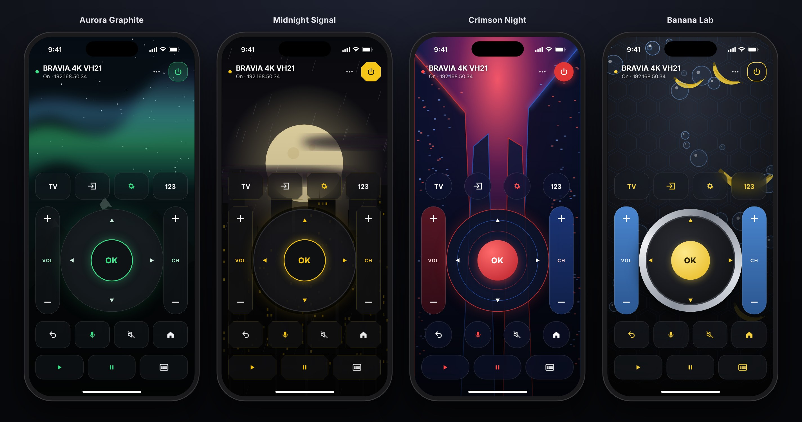
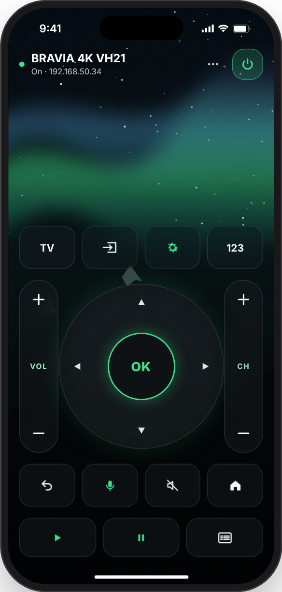
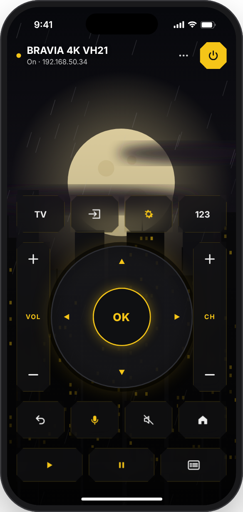
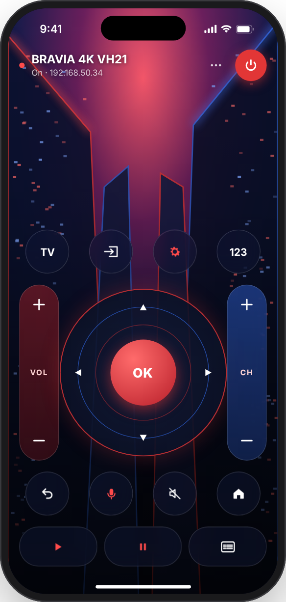
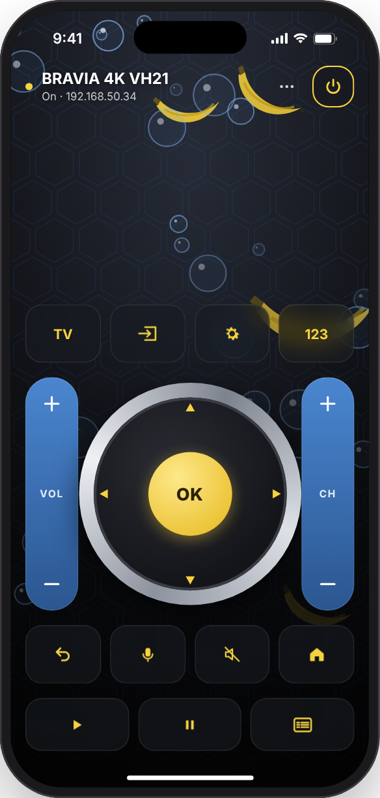
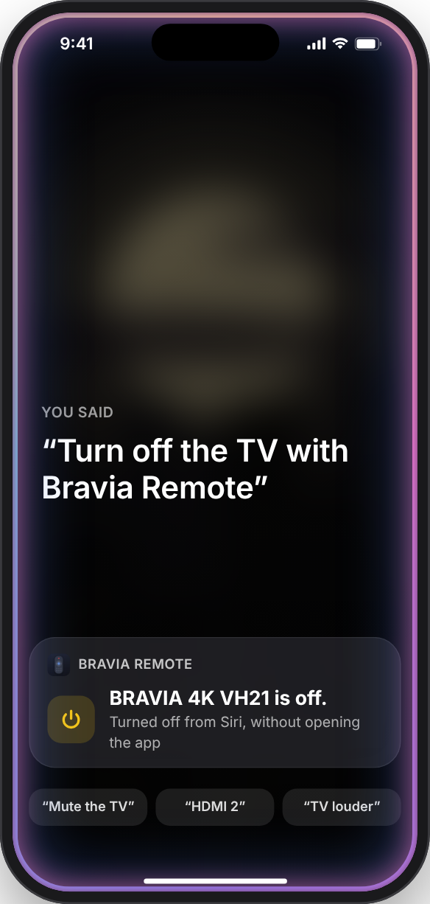
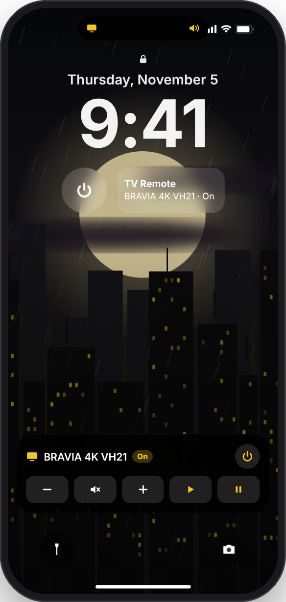

<div align="center">

# Bravia Remote

**A free, open‑source iPhone remote for Sony BRAVIA Google TVs. It works over Wi‑Fi with no IR blaster, no account and no ads, and you can pick from four poster themes.**

[](#requirements)
[](#build-from-source)
[](#architecture)
[](#architecture)
[](LICENSE)
[](../../releases/latest)

<br>



</div>

---

## Contents

- [Features](#features)
- [Themes](#themes)
- [Voice control & Lock Screen remote](#voice-control--lock-screen-remote)
- [Requirements](#requirements)
- [Install](#install)
- [TV setup](#tv-setup)
- [Pairing](#pairing)
- [Build from source](#build-from-source)
- [Publishing a release](#publishing-a-release)
- [Architecture](#architecture)
- [Sony REST API reference](#sony-rest-api-reference)
- [Troubleshooting](#troubleshooting)
- [Changelog](#changelog)
- [Contributing](#contributing)
- [License](#license)
- [Disclaimer](#disclaimer)

---

## Features

| | |
|---|---|
| 🗣️ **Siri & Shortcuts** | "Turn off the TV with Bravia Remote". Actions for power, volume, buttons, HDMI and apps. |
| 🧩 **Widgets & controls** | Interactive Home Screen and Lock Screen widgets, plus Control Center controls on iOS 18. |
| 🔒 **Lock Screen remote** | Volume, mute, play/pause and power on the Lock Screen and in the Dynamic Island. |
| 🔁 **Auto‑reconnect** | Finds the TV again if its IP address changes. |
| 📺 **Multiple TVs** | Pair every BRAVIA in the house and switch by tapping the TV name. |
| 🔀 **Input picker** | Jump straight to HDMI 1–4, with the names you gave them on the TV. |
| 🔊 **iPhone volume buttons** | Control the TV volume with your phone's side buttons while the remote is open. |
| 📡 **Finds your TV automatically** | Finds the TV on your Wi‑Fi with Bonjour. You can also type its IP address. |
| 🔐 **Two ways to pair** | 4‑digit PIN or Pre‑Shared Key. Credentials are kept in the iOS Keychain, and the PIN session renews itself. |
| 🎛️ **Full remote layout** | Power · TV · Input · Settings · 123 · D‑pad · VOL± · CH± · Back · Home · Voice · Mute · Play · Pause · Guide. |
| 👍 **Thumb‑zone design** | The controls sit low on the screen. Volume and channel are on each side of the D‑pad, so there are no wasted rows. |
| 🔁 **Hold to repeat** | Holding an arrow, volume or channel key keeps sending it. Every press gives haptic feedback. |
| ⌨️ **Voice & type** | Sends text to the TV's search box. Use the iPhone keyboard's 🎤 to dictate. |
| 📺 **App launcher** | Lists every app installed on the TV, with one‑tap YouTube, Netflix, Disney+ and Prime Video. |
| 🎨 **Four themes** | Each theme has its own original poster, key shapes and D‑pad. Switch instantly from **⋯ → Theme**. |
| 📱 **Sized for every iPhone** | Separate layouts for SE / mini, standard and Pro Max screens. |
| ♿ **Accessible** | Dynamic Type, Bold Text and VoiceOver labels on every key. |
| 🪶 **Zero dependencies** | Built only with SwiftUI, Foundation, Network and Security. |

## Themes

<table>
  <tr>
    <td align="center"><br><b>Aurora Graphite</b><br><sub>Northern lights · mint glass</sub></td>
    <td align="center"><br><b>Midnight Signal</b><br><sub>Rainy skyline · amber · angled keys</sub></td>
    <td align="center"><br><b>Crimson Night</b><br><sub>Neon towers · red & blue</sub></td>
    <td align="center"><br><b>Banana Lab</b><br><sub>Bubbles & bananas · silver ring</sub></td>
  </tr>
</table>

Switch themes from **⋯ → Theme**, or in **⋯ → More keys & settings**. The app remembers your choice.

## Voice control & Lock Screen remote

<table>
  <tr>
    <td align="center" width="50%"><br><b>Siri & Shortcuts</b></td>
    <td align="center" width="50%"><br><b>Lock Screen remote</b></td>
  </tr>
  <tr>
    <td valign="top">

Control the TV hands‑free. Siri runs the command in the background, without opening the app.

- “Turn **on** / **off** the TV with Bravia Remote”
- “Mute the TV with Bravia Remote”
- “Turn up the TV with Bravia Remote”
- “Switch the TV to **HDMI 2** with Bravia Remote”
- “Bravia Remote **Home**” (any remote button)

All of these are also **Shortcuts actions**, so you can run them from automations (e.g. TV off at midnight) or the **Action button**.

</td>
    <td valign="top">

Turn on **⋯ → Lock Screen remote** to get the TV's power, volume, mute and play/pause on the Lock Screen and in the **Dynamic Island**. No unlocking needed.

Also in v1.2:

- **Home Screen widgets:** *TV Remote* (small / medium) and *TV Power*
- **Control Center controls (iOS 18):** *TV Power* and *Mute TV*
- Everything uses your theme's colors

</td>
  </tr>
</table>

## Requirements

| | |
|---|---|
| **TV** | Sony BRAVIA with the IP Control REST API. Built for the 2021 **VH21** Google TV platform (X80J / X85J / X90J / A80J). Other 2016+ Android TV and Google TV BRAVIAs should also work. |
| **iPhone** | iOS 17 or later |
| **Network** | iPhone and TV on the same Wi‑Fi |
| **To build** | macOS with **Xcode 16+**, or just GitHub Actions (see below) |

## Install

1. Download **`BraviaRemote-unsigned.ipa`** from the [**latest release**](../../releases/latest).
2. Sideload it with [Sideloadly](https://sideloadly.io) or [AltStore](https://altstore.io). The tool signs the app with your own Apple ID.
3. Open **Bravia Remote**, allow **Local Network** access, then pick your TV.

> [!NOTE]
> With a free Apple ID, sideloaded apps expire after 7 days. Re-sideload the IPA, or use a paid developer account (1 year).

## TV setup

Do this once on the TV:

1. **Settings › Network & Internet › Remote device settings › Control remotely** → **On**
2. *(Optional)* **Settings › Network & Internet › Remote Start** → **On**. This lets the app power the TV on from standby.
3. *(Only for the Pre‑Shared Key method)* **Settings › Network & Internet › Home network › IP control**:
   set **Authentication** to **Normal and Pre‑Shared Key** and choose a key, for example `0000`.

## Pairing

| Method | How it works |
|---|---|
| **PIN code** *(default)* | Tap **Connect**. A 4‑digit PIN appears on the TV; type it into the app. Each pairing attempt uses a new client ID, so the TV always shows a fresh PIN. |
| **Pre‑Shared Key** | Choose *Pre‑Shared Key*, enter the key you set on the TV and tap **Connect**. No pop‑up is involved, which makes it the most reliable method. |

## Build from source

```bash
git clone <this-repo-url> && cd BraviaRemote
open BraviaRemote.xcodeproj        # pick your Team under Signing & Capabilities, then ⌘R
```

Build an unsigned IPA locally:

```bash
bash scripts/build-unsigned-ipa.sh                       # → build/BraviaRemote-unsigned.ipa
MARKETING_VERSION=1.2.0 BUILD_NUMBER=42 bash scripts/build-unsigned-ipa.sh
```

### Continuous integration

| Workflow | Trigger | Output |
|---|---|---|
| [`build-ipa.yml`](.github/workflows/build-ipa.yml) | Every push to `main` | IPA as a workflow **artifact** (signed‑in users only, kept 90 days) |
| [`release.yml`](.github/workflows/release.yml) | Pushing a `v*` tag, or a manual run | A public **GitHub Release** with the IPA attached |

## Publishing a release

1. Add a section for the new version to [`CHANGELOG.md`](CHANGELOG.md) (`## [1.2.0] — date`, with what's new and what's fixed). It becomes the release notes.
2. Commit it, then tag and push:

```bash
git tag v1.2.0
git push origin v1.2.0
```

GitHub Actions builds the IPA on a macOS runner and stamps it with version `1.2.0`. It then publishes **Bravia Remote v1.2.0**, using that version's changelog section as the notes, with `BraviaRemote-unsigned.ipa` attached.
You can also run it without a terminal: **Actions → Release IPA → Run workflow**, then enter a tag.

The download link always points to the newest release:

```
https://github.com/<owner>/<repo>/releases/latest/download/BraviaRemote-unsigned.ipa
```

> [!IMPORTANT]
> Release downloads are public only if the repository is **public**. On a private repo, only collaborators can download them.

## Architecture

```
Shared/                           Compiled into the app and the widget extension
├─ BraviaClient.swift             Sony REST (JSON‑RPC) + IRCC (SOAP), cookie / PSK auth
├─ PairingConnection.swift        Minimal raw HTTP/1.1 client for the PIN handshake
├─ RemoteIntents.swift            App Intents: power, buttons, volume, mute, HDMI, open app
├─ RemoteCommandRunner.swift      Runs commands without UI (Siri, widgets, controls)
├─ RemoteActivityAttributes.swift Lock Screen remote model + widget colors
├─ TVStore.swift                  Saved TVs (app group), migrations
├─ KeychainStore.swift            Keychain in the shared access group
├─ RemoteKey.swift                Key names + fallback IRCC codes
└─ AppGroup.swift                 Shared defaults
BraviaRemoteWidgets/              Widget extension: widgets, Live Activity, Control Center controls
BraviaRemote/
├─ BraviaRemoteApp.swift          App entry · theme injection · setup ↔ remote routing
├─ AppShortcuts.swift             Siri phrases / Shortcuts tiles
├─ LiveActivityController.swift   Starts / updates the Lock Screen remote
├─ RemoteViewModel.swift          State, serialized command queue, pairing, error handling
├─ Services/
│  ├─ HardwareVolume.swift        iPhone volume buttons → TV volume
│  └─ TVDiscovery.swift           Bonjour (_googlecast._tcp) discovery + IPv4 lookup
├─ Views/
│  ├─ RemoteView.swift            Main remote layout + per-screen-size metrics
│  ├─ Theme.swift                 AppTheme tokens, poster background, themed keys / rockers / D‑pad
│  ├─ SetupView.swift             Discovery, IP entry, PIN / PSK pairing
│  ├─ Sheets.swift                Apps, Inputs, Voice & Type, Number pad, Settings
│  ├─ Components.swift            RemoteButton (press & hold‑to‑repeat), shared keys, toast
│  └─ RemoteIcons.swift           Custom glyphs (Input, Guide, volume wedge)
└─ Assets.xcassets                App icon, accent colour, theme posters
```

**Design notes**

- Key presses go through a **serial queue**, so they reach the TV in order. Commands are dropped while the TV is unreachable, instead of piling up.
- On connect, the app loads the **TV's own IRCC code table** (`getRemoteControllerInfo`). It falls back to the standard Sony codes only when that fails.
- Widget, Lock Screen and Control Center buttons use App Intents that adopt `LiveActivityIntent`. iOS then runs them in the app's own process in the background, where the TV pairing and Local Network permission already exist.
- PIN pairing uses a raw socket instead of `URLSession`, because `URLSession`'s automatic handling of the `401` reply made the TV cancel the PIN pop‑up.

## Sony REST API reference

| Purpose | Endpoint | Method |
|---|---|---|
| Pair / renew | `POST /sony/accessControl` | `actRegister` |
| Button press | `POST /sony/IRCC` | SOAP `X_SendIRCC` |
| Button codes | `POST /sony/system` | `getRemoteControllerInfo` |
| Power | `POST /sony/system` | `getPowerStatus`, `setPowerStatus` |
| TV info | `POST /sony/system` | `getSystemInformation` |
| Apps | `POST /sony/appControl` | `getApplicationList`, `setActiveApp` |
| Inputs | `POST /sony/avContent` | `getCurrentExternalInputsStatus`, `getPlayingContentInfo`, `setPlayContent` |
| Text input | `POST /sony/appControl` | `setTextForm` |

Auth is either an `auth` cookie from PIN pairing, or an `X-Auth-PSK: <key>` header for the Pre‑Shared Key method.

## Troubleshooting

<details>
<summary><b>"Couldn't reach the TV"</b></summary>

- Check the IP: on the TV, open **Settings › Network & Internet** and select your network.
- Make sure **iOS Settings › Bravia Remote › Local Network** is on.
- The iPhone and TV must be on the same Wi‑Fi. Guest networks often block device‑to‑device traffic.
</details>

<details>
<summary><b>No PIN appears, or the TV says "Registration cancelled"</b></summary>

- The TV must be **on**, not in standby.
- Remove old entries under **Remote device settings › Deregister remote device**, then try again.
- If **IP control › Authentication** is set to *Pre‑Shared Key* only, the TV never shows a PIN. Use the PSK method instead.
</details>

<details>
<summary><b>Power‑on doesn't work</b></summary>

Turn on **Remote Start**. If the TV is fully powered off with Remote Start disabled, it isn't on the network.
</details>

<details>
<summary><b>"Pairing expired"</b></summary>

Open **⋯ → More keys & settings → Forget this TV**, then pair again.
</details>

## Changelog

See [CHANGELOG.md](CHANGELOG.md).

## Contributing

Contributions are welcome! Bug fixes, new themes, support for more BRAVIA models and translations are all appreciated.

1. Fork the repo and create a branch: `git checkout -b feature/my-idea`
2. Keep the app dependency‑free and follow the existing SwiftUI style.
3. Open a pull request. CI builds an IPA for every push, so you can test it on a device.

Found a bug or have an idea? [Open an issue](../../issues).

## License

Released under the [MIT License](LICENSE): free to use, modify and share, for personal or commercial projects.

## Disclaimer

Bravia Remote is an independent hobby project. It is **not affiliated with, endorsed by, or sponsored by Sony**.
BRAVIA and Sony are trademarks of Sony Group Corporation. YouTube, Netflix, Disney+ and Prime Video are trademarks of their respective owners.
All theme artwork is original.
